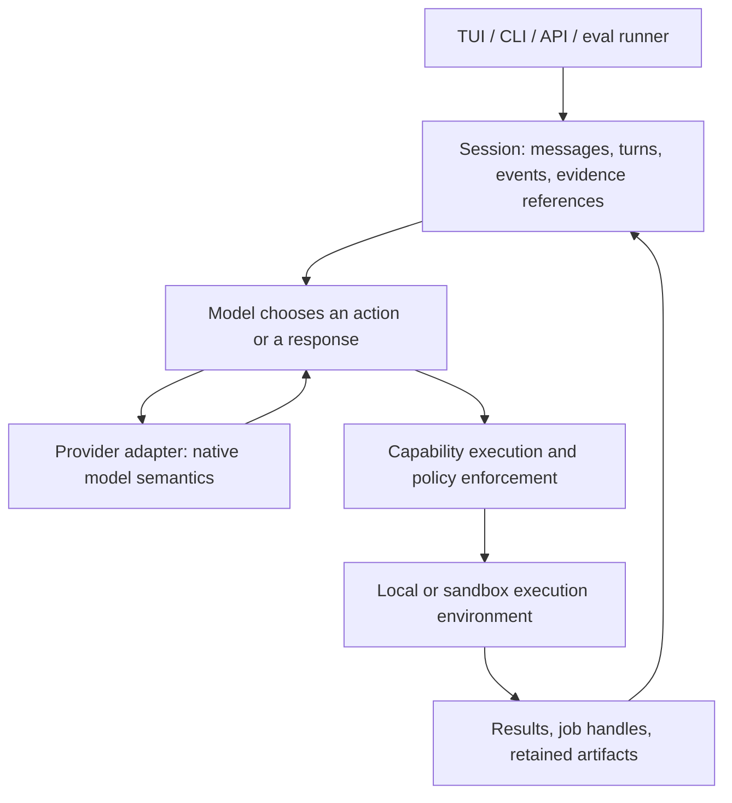

# Default v2: target harness design

Status: runtime implementation under review, 2026-11-11. The delivery section
distinguishes implemented contracts from research-quality validation. No performance
improvement is claimed without comparative runs.

## Objective

Apex is a capable conversational agent specialized for security research. It
follows the user's objective, evaluates hints, develops evidence, and pursues
the requested depth of investigation. The model chooses the research strategy.
The harness supplies reliable execution, relevant context, and enforced scope.

Design against the documented behavior of frontier harnesses first. Existing
Apex code earns reuse by satisfying these contracts. Similar component names,
historical architecture decisions, or the presence of an API are insufficient.

## Architecture

These are ownership boundaries, not a requirement for new services, packages,
or an interface hierarchy. Start with one in-process implementation and the
execution adapters the product actually needs.

## Decisions

### 1. One adaptive primary agent owns the investigation

The primary model interprets the request, chooses experiments, revises its
explanation, and decides what evidence is still needed. It can move between
source inspection, protocol experiments, coding, reproduction, and explanation
without changing agent personas or satisfying stage transitions.

Security instructions specify evidence standards, scope, and completion
expectations. They do not prescribe a universal methodology. A request to
demonstrate impact requires a demonstrated result or a precise account of the
remaining blocker; a question or triage request has its own appropriate depth.
A failed experimental setup remains inconclusive. A user hint is a lead to
evaluate, and later corrections update the active assignment.

Delegation is an exception for an explicitly requested or clearly beneficial
independent task. The main investigation stays with its accumulated context.
This is our design choice, not a claim that frontier harnesses have eliminated
subagents. Independent tool calls and scripts can still run concurrently.

Claude Code documents a loop that adapts to the request and previous results,
with extensions layered over its core tools. [Claude Code architecture](https://code.claude.com/docs/en/how-claude-code-works).

### 2. A session owns the loop across every interface

One owner assembles model input and manages messages, tool results, pending
execution, approvals, cancellation, compaction, and completion. Clients submit
user input and render events. An environment provides execution capabilities
and actual runtime facts; it does not select a pentest methodology.

A reconnect, new user turn, or change of interface must not silently create a
different research policy. Separate turn completion, task outcome, and process
termination. An exhausted budget or failed tool must not be recorded as a
verified result.

Codex exposes shared conversation and execution behavior to product clients
through its app-server. This motivates the ownership boundary; it does not
require Apex to reproduce that transport. [Codex platform](https://developers.openai.com/blog/codex-as-a-platform),
[app-server](https://developers.openai.com/codex/app-server).

### 3. Preserve the capabilities of the selected model

Provider adapters must preserve supported reasoning items, tool-call identities,
ordering, output formats, and requested reasoning settings. Do not reduce all
providers to the smallest common message format or silently change the model
doing the investigation. Treat opaque provider state as opaque.

For supported OpenAI models, use append-only conversation updates and the
documented continuation and compaction mechanisms. Shorten a large tool result
before its first inclusion in model input, retaining the full artifact. Do not
quietly rewrite already-consumed history on each subsequent step. Other
providers require their own documented semantics and conformance tests.

OpenAI documents that reasoning items must accompany tool results and that
prefix edits can discard subsequent reasoning. Native OpenAI compaction has
different preservation behavior from arbitrary history rewriting. This makes
history handling a capability requirement, beyond a token-cost optimization.
[Reasoning continuation](https://developers.openai.com/api/docs/guides/reasoning#keeping-reasoning-items-in-context),
[prefix preservation](https://developers.openai.com/api/docs/guides/preserved-reasoning).

### 4. Expose a small, clear set of composable capabilities

Make file inspection and editing, search, command execution, relevant network
or browser interaction, artifact retrieval, and capability discovery easy to
use. Each operation states its real effects, state ownership, and result
contract. Additional security and workspace capabilities are discoverable.

Discovery must respect provider history semantics: use supported additive tool
updates or a stable discovery/invocation surface. Avoid changing previous tool
definitions just to reduce the currently displayed catalog. Permission checks
apply at invocation, including programmatic and discovered calls.

Recording evidence, generating analysis, delegating work, and publishing a
finding are distinguishable operations. If an operation includes validation or
additional execution, its contract makes that explicit. Preserve the evidence
requirements for publishing confirmed findings.

Anthropic recommends unambiguous tools with little overlap and retrieving
context when needed. Those recommendations motivate the capability surface;
the exact Apex tool set remains an evaluation question.
[Context engineering](https://www.anthropic.com/research/effective-context-engineering-for-ai-agents).

### 5. Preserve a useful investigation workspace

Keep scripts, captured requests, source references, experimental results, and
working reproductions available throughout the session. Return concise results
with retrievable references and enough surrounding evidence to interpret them.
Preserve exact security-relevant bytes when an experiment depends on them.

The model can keep research notes when useful. Compaction preserves the current
objective, corrections, constraints, unresolved leads, successful primitives,
and evidence references. Distinguish user statements, observed results, and
model hypotheses. Do not introduce a mandatory per-action ledger or a second
model that decides the research strategy.

Claude Code documents on-demand skills and tool definitions, alongside
compaction and persistent project instructions. These mechanisms support
selective context loading; they do not guarantee that every important clue
survives. [Claude Code context](https://code.claude.com/docs/en/how-claude-code-works#the-context-window).

### 6. Make sustained experiments observable and controllable

An operation that outlives a tool response returns an owned job or session
handle. The model can inspect partial output, continue where supported, cancel,
and retrieve final artifacts. Execution state such as working directory,
environment, authentication, and process lifetime has explicit semantics.

Enforce permission, time, concurrency, and resource limits in execution code.
Expose budget exhaustion accurately. Do not equate a long investigation with
failure or force a hypothesis pivot after an arbitrary number of negatives.
Research depth is judged by the user's objective and the evidence obtained.

## Observable acceptance criteria

| Desired behavior                                                  | Invariant and enforcement                                                                                                                          | Verification                                                                                                                                              |
| ----------------------------------------------------------------- | -------------------------------------------------------------------------------------------------------------------------------------------------- | --------------------------------------------------------------------------------------------------------------------------------------------------------- |
| Apex follows a specific research request and later corrections.   | User messages remain authoritative; tool content cannot change scope. Session assembly and capability policy own these boundaries.                 | Multi-turn tasks with precise hints, corrections, and prohibited broad scans; test before and after compaction.                                           |
| Apex investigates a promising lead to the requested depth.        | A finding or intermediate primitive does not automatically complete an impact objective. Outcome reporting distinguishes evidence from hypotheses. | Held-out source-assisted and black-box tasks requiring a reproduction and independently verified impact; include failed setup and negative-control cases. |
| Apex challenges an incorrect hint with evidence.                  | A user's hypothesis is not automatically stored as an observed fact.                                                                               | Paired tasks with useful, ambiguous, and misleading hints; score outcome and supporting evidence.                                                         |
| Model state survives ordinary tool round trips.                   | Provider-owned state and item ordering are preserved through the supported adapter path.                                                           | Request-capture conformance tests for repeated tool calls, new user input, resume, tool discovery, and compaction; verify supported native settings.      |
| TUI, CLI, and API use the same session behavior.                  | Clients do not inject independent workflow policy; environments report facts and execute.                                                          | Run the same scripted conversation through each entry point with deterministic tools; compare model-visible semantics.                                    |
| A long experiment remains inspectable and has a truthful outcome. | Every live job has an owner; cancellation and failure cannot produce fabricated success.                                                           | Partial output, timeout, cancellation, reconnect, and final-artifact integration checks against actual execution adapters.                                |

Behavioral acceptance requires real-model evaluations. Structural tests prove
contracts, not research quality. Use existing evaluation infrastructure where
it meets the test requirements; adding another evaluation platform is outside
this design.

Compare matched model, reasoning settings, task, environment, and budget where
possible. Native Codex and Claude Code runs are product baselines. Cross-model
comparisons do not isolate harness effects. Repeat tasks, retain denominators,
and hold out tasks from design work. Do not grade a single prescribed tool
sequence.

The primary measures are verified task completion and demonstrated security
impact with false-positive control. Also measure hint use, unwanted workflow
launches, loss of corrections after compaction, time, cost, and unfinished
viable leads. More tool calls, fewer tool calls, or more findings alone are not
success criteria.

## Delivery through the default-v2 stack

The stack now supplies the following runtime behavior when `default-v2` is selected:

| Boundary                           | Implementation                                                                                                                                                                                                                                                                                                                                                                                 |
| ---------------------------------- | ---------------------------------------------------------------------------------------------------------------------------------------------------------------------------------------------------------------------------------------------------------------------------------------------------------------------------------------------------------------------------------------------- |
| Conversation ownership             | `ResearchContext` owns the durable working context, original instructions, positioned updates, and retained context journal. TUI and CLI submit `newMessages`; the public API and direct agent construction use the same context owner.                                                                                                                                                        |
| Ordinary continuation              | Preserve message parts and provider metadata, maintain tool-result ordering, and append corrections and question answers. The original system prefix stays fixed; changed session instructions append as a new system message.                                                                                                                                                                 |
| OpenAI compaction                  | Supported direct GPT-5.3+ Responses models use native compaction, `store: false`, and opaque SDK custom parts. GPT-6 uses explicit `compaction_trigger` to coexist with positioned configuration updates; GPT-5 uses server-managed thresholds. Only a returned native marker permits prefix pruning. Native context errors fail explicitly rather than silently converting to a text summary. |
| Reasoning settings                 | Supported GPT-6 effort changes append positioned updates while retaining request-level effort. After native compaction the latest update is restated. Other providers retain their supported settings; unsupported positioned updates are explicit configuration boundaries.                                                                                                                   |
| Other providers and model switches | Compaction uses the selected model and disables tool execution for the summary. Switching models replays retained evidence from the journal, omitting provider-specific opaque state and reasoning. This is a model boundary, not a promise of reasoning continuity across models.                                                                                                             |
| Capability surface                 | Legacy recon/pentest orchestration and built-in specialist spawners are absent from v2 registry discovery and construction, including code-mode invocation and conflicting injected names. Direct primitives, workspace operations, skills, and owned experiment jobs remain.                                                                                                                  |
| Endpoint observations              | `document_endpoint_v2` writes supplied facts and evidence references under `observations/endpoints`. It does not score risk, generate threats, invoke another model, create workspace endpoints, or launch follow-on work. Legacy `document_app` is also excluded.                                                                                                                             |
| Completion and interruption        | The API drains v2 execution before returning; client cancellation can be awaited. The TUI waits for cancellation cleanup before another run and leaves persisted context to the core. Interrupted tool results are checkpointed through the same recorder.                                                                                                                                     |

`research-context.json` is the current v2 working context. `research-context.jsonl`
retains context changes, including evidence preceding compaction. `messages.json`
remains a compatibility projection for existing readers. Host-supplied recorded-run
context is committed through its existing recorder before the local snapshot.
Execution, approvals, retained artifacts, and job handles continue to use the
existing agent/runtime/backend contracts; no separate workflow scheduler is added.

Model-visible tool results are now a separate presentation from captured execution
evidence. New file/search/command result batches receive a shared preview budget
before persistence and the next model request. Omitted captured text is retained
behind an agent-owned reference that supports reading and searching. The exact
presentation is reused on subsequent steps; previously consumed messages and opaque
reasoning are not edited. Producer truncation remains explicitly marked as incomplete
capture. Initial preview sizes are experimental, not a claim of optimal tuning.

Session instruction changes append only the changed span, and skill catalogs have a
stable order. A local v2 launch directory is a default location, not an implicit source
scope: profiling, queries, scans, and jobs accept explicit repository paths while
configured codebase and file-workspace boundaries remain enforced. V2 skills supply
optional expertise; the threat-model capability and its TUI entry points impose no
phase sequence or report quotas.

The SDK 7 foundation requires a coordinated Console dependency and middleware
migration. Its downstream compatibility check must pass against the matching
Console revision before merge. This is integration work, not an interface redesign.

Contract tests exercise opaque-state persistence and actual Responses serialization,
compaction admission, positioned settings, user corrections, model handoff, failed
persistence, and exclusion of legacy workflow tools. These tests do not establish
research-quality or latency improvements. Dogfood the existing research tasks and
evaluation infrastructure before changing the product default.

No automatic hypothesis-ranking service, mandatory recon checklist, fixed
research phases, or additional orchestration layer is part of this design.
Add such machinery only if controlled evidence demonstrates a need that the
primary model and existing execution primitives cannot satisfy.
